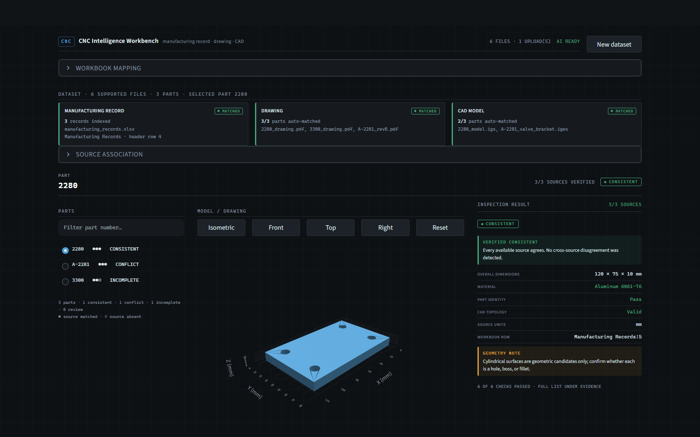

# CNC Part Analyzer

Verify a manufactured part across three independent sources — a manufacturing record
(Excel), an engineering drawing (PDF), and a CAD model (IGES) — and show exactly which
evidence supports every statement.

Built for the SPEC'26 LLM-Based CNC Part Analysis challenge.

Read the **[technical architecture](docs/TECHNICAL_ARCHITECTURE.md)** for the complete
pipeline, RAG/LLM boundary, dataset portability, and limitations. Building the pitch?
See **[docs/PRESENTATION_BRIEF.md](docs/PRESENTATION_BRIEF.md)**.

[](https://colab.research.google.com/github/MrZeeshan6009/CNC/blob/main/dist/CNC_Part_Analyzer_Colab.ipynb)



---

## What it does

- **One click to a real result.** The bundled demo dataset loads without a download;
  every part is measured up front so switching parts is instant.
- **Deterministic first.** Excel parsing, PDF extraction, IGES measurement with
  OpenCascade, source association, and the cross-source audit all run locally. Those
  checks decide the status badge.
- **The model explains, never decides.** DeepSeek receives only verified evidence
  (workbook cells, retrieved drawing text, measured CAD metadata). Every citation it
  returns is validated against real cells, page numbers, and calculated CAD fields;
  unsupported citations are dropped and confidence is downgraded.
- **Honest about gaps.** A missing source produces *Incomplete*, never *Conflict*.
  A conflict is raised only when supplied sources actually disagree.
- **Nothing is guessed.** Ambiguous drawings/models require an explicit choice;
  unrelated files are never silently associated.

### Status vocabulary

| Badge | Meaning |
| --- | --- |
| **Consistent** | Every available source agrees |
| **Conflict** | Supplied sources disagree on a checked value |
| **Incomplete** | At least one source is absent; dependent checks were not run |
| **Review** | No confirmed conflict, but a check needs a human decision |

---

## Quick start

```powershell
python -m venv .venv
.venv\Scripts\Activate.ps1
pip install -r requirements-dev.txt
Copy-Item .env.example .env      # then put your DeepSeek key in .env
streamlit run app.py
```

Open `http://localhost:8501`, click **Run demo**.

Add `?dataset=demo` to the URL to jump straight into the demo, and to survive a
browser refresh.

---

## The demo dataset

`outputs/stretch_dataset/cnc_stretch_dataset.zip` — synthetic, safe to show.

| Part | Expected result | Why it exists |
| --- | --- | --- |
| `2280` | **Consistent** | Excel, drawing, and IGES agree; 120 × 75 × 10 mm, 4 × Ø10 holes |
| `A-2281` | **Conflict** | Drawing says 80 mm, CAD measures 82 mm |
| `3300` | **Incomplete** | Excel + drawing present, IGES intentionally absent |

---

## Hosting

Judges only need a URL.

**Colab host (primary).** Click the **Open in Colab** badge or upload
`dist/CNC_Part_Analyzer_Colab.ipynb`, use a CPU runtime, and run its three cells in order.
Enter the DeepSeek key when requested and share the printed `trycloudflare.com` URL.
The notebook clones this public repository; it contains no embedded Base64 project,
project ZIP, or secret. Rebuild it with:

```powershell
python scripts/build_colab_assets.py
```

Only the DeepSeek key is entered by the operator, and it remains in the Colab session.

See [DEMO_RUNBOOK.md](DEMO_RUNBOOK.md) for the short judging workflow.

### Docker

```powershell
docker build -t cnc-part-analyzer .
docker run --rm -p 8501:8501 --env-file .env cnc-part-analyzer
```

The image installs `libgl1`, `libglib2.0-0`, and `libgomp1` because OpenCascade and VTK
link against `libGL` (a bare `python:3.12-slim` fails to import `OCP` with
`ImportError: libGL.so.1`). It declares a `HEALTHCHECK` against `/_stcore/health` and
runs `python -m src.startup` before Streamlit, which refuses to start if the CAD engine
cannot be imported.

Colab is the recommended judging route; Docker is provided for a conventional persistent
deployment after environment-specific validation.

---

## Architecture

The deterministic audit decides engineering status; DeepSeek only explains verified
evidence. See [docs/TECHNICAL_ARCHITECTURE.md](docs/TECHNICAL_ARCHITECTURE.md) for the
data flow, detailed LLM contract, RAG design, portability strategy, and limitations.

```
app.py                  orchestration only: ingest → validate → measure → workspace
ui/
  theme.py              palette, status vocabulary, stylesheet injection
  state.py              session state, dataset/analysis signatures, result cache
  components.py         pills, cards, key/value rows, findings, callouts
  caching.py            cached PDF/CAD extraction and page rendering
  views/
    start.py            one-click demo and file upload
    dataset.py          workbook mapping and file association when needed
    workspace.py        part summary, 3D/drawing viewer and results
    evidence.py         check results, per-source evidence, technical JSON, dataset map
    assistant.py        preset questions, chat, validated citations
assets/styles.css       engineering workstation theme
src/                    unchanged analysis core (see below)
```

The analysis core is stable and independent of the UI:

| Module | Responsibility |
| --- | --- |
| `src/dataset_manager.py` | ZIP safety, ingestion, conservative source association |
| `src/excel_reader.py` | Workbook discovery, part lookup, cell-level evidence |
| `src/pdf_reader.py` | Text extraction, OCR/vision fallback, lightweight RAG, page rendering |
| `src/cad_reader.py` | IGES measurement with OpenCascade, standard views |
| `src/cross_check.py` | Deterministic cross-source audit |
| `src/llm_client.py` | DeepSeek call and citation validation |
| `src/models.py` | Shared data contracts |
| `src/startup.py` | Startup diagnostics (never logs the key) |

Session-state keys and the dataset/analysis signature behaviour are preserved from the
original implementation, so results are invalidated when files or mappings change.

---

## Configuration

| Variable | Default | Purpose |
| --- | --- | --- |
| `DEEPSEEK_API_KEY` | none | Required for AI answers only |
| `DEEPSEEK_MODEL` | `deepseek-flash` | Model name |
| `DEEPSEEK_BASE_URL` | `https://api.deepseek.com` | API endpoint |

Never commit `.env`. Startup diagnostics print whether a key is configured, never its
value.

---

## Tests

```powershell
pytest -q          # 38 passed
```

The suite covers Excel discovery, drawing retrieval, CAD processing, citation
validation, source-independent dataset indexing, malicious/ambiguous ZIP cases,
partial-source combinations, and every cross-source audit outcome.

The optional browser smoke test requires a running app and Playwright Chromium:

```powershell
playwright install chromium
python scripts/ui_regression.py
```

It verifies the minimal start screen, bundled demo analysis, and simplified DeepSeek tab.

---

## Partial-source behaviour

| Available sources | Supported analysis |
| --- | --- |
| Excel only | Manufacturing record lookup and cited Q&A |
| PDF only | Drawing extraction, RAG, notes, dimensions, tolerances, cited Q&A |
| IGES only | Deterministic geometry, topology, standard views, cited Q&A |
| PDF + IGES | Drawing-to-model dimension and cylindrical-feature cross-checks |
| Excel + PDF | Identity and material checks |
| Excel + IGES | Record plus deterministic CAD facts |
| All three | Complete cross-source audit |

---

## Limitations and safety boundary

- Only IGES is supported in the CAD pipeline; STEP and native CAD formats are future work.
- IGES does not reliably preserve material, tolerance, or process information.
- Cylindrical-surface detection does not by itself distinguish holes, bosses, and fillets.
- OpenCascade transfers IGES into its millimetre-based model; unusual source units need
  manual confirmation, and a valid topology does not prove correct scale.
- Automatic header detection uses common aliases and may require manual mapping.
- Filename association is deterministic and conservative; ambiguity requires a choice.
- Vision fallback processes the first three pages of image-only drawings.
- Engineering symbols, dense GD&T frames, and leader-line relationships can need review.
- The application does not infer missing manufacturing values.
- An API connection is required only for DeepSeek explanations. Everything else runs locally.
- **This is an engineering review aid, not an automatic manufacturing release or
  inspection certificate.**

---

Module edits under `ui/` or `src/` require a Streamlit restart because Python imports are
cached for the running process.
